# UML du projet

Diagramme de classes en couches, à compléter au fur et à mesure (s'affiche dans VS Code avec l'aperçu Markdown + Mermaid, et sur GitHub) :
en haut la **sortie** (`Station`, les graphiques), au milieu l'**intelligence** (X et Y, modèles), en bas les **trois sources**
(BasinATLAS, Open-Meteo, RiverApp) et les réglages. Le détail de chaque case est dans les [fiches](#fiches) sous le diagramme.

Conventions : losange plein = composition (la partie appartient au tout) ; trait plein + flèche = association (connaît) ;
pointillés + flèche = dépendance (utilise) ; `1`, `0..1`, `0..*`, `1..*` = multiplicités ; `+` public, `-` privé,
`$` méthode de classe ; `<<...>>` = stéréotype (nature de la case).

```mermaid
classDiagram
  direction TB
  namespace Sortie {
    class graphes_py {
      <<module de fonctions>>
      +explorer(cles, fenetre, noms, titre, fichier) Figure
      +explorer_pluie(carreaux, fichier, debut, fin, heures, modele) Path
    }
    class Station {
      +str id, identifiant RiverApp
      +str code chez le fournisseur
      +str nom, cours_eau
      +float lon, lat
      +datetime debut_donnees
      +int bassin, entrée dans l arbre
      +DataFrame carreaux
      +Reseau reseau, partagé
      +Path dossier_modeles
      +mesures(debut, fin, pas, trou_max, filtre) DataFrame
      +features(debut, fin, filtre) Features, nouveau et vide
      +modeles() DataFrame, meilleur R² en premier
      +charger(cle) Modele
      +resultats(cle) dict
    }
  }
  namespace Intelligence {
    class Features {
      +str id_station
      +str debut, fin
      +int zone
      +DataFrame carreaux
      +DataFrame entrees, recette de X : type carreau variable depuis jusqu_a pas
      +DataFrame cibles, recette de Y : duree pas
      +set colonnes_retirees
      +dict colonnes_par_cible, colonnes de X par échéance
      +DataFrame X, vide jusqu à construire
      +DataFrame Y, vide jusqu à construire
      +Series debit_actuel, débit à t
      +ajouter_meteo(variables, carreaux, depuis, pas, jusqu_a, avant_echeance, apres_echeance) Features
      +ajouter_debit(depuis, pas) Features
      +ajouter_date() Features
      +ajouter_cible(duree, pas) Features
      +retirer(type, carreau, variable, pas) Features
      +retirer_colonnes(noms) Features
      +retirer_cibles(numeros) Features
      +choisir_carreaux(k_max, seuil, criteres, poids, dedans_min, largeur) DataFrame
      +recette() dict
      +depuis_recette(recette)$ Features
      +construire() Features
      +annees() list
      +decouper(test, val) X_train, Y_train, X_val, Y_val, X_test, Y_test
      +validation_croisee(test, n_plis) plis
      -_colonnes_vides()
    }
    class features_py {
      <<module de fonctions>>
      -_heures(duree) int
      -_bloc(depuis, jusqu_a, pas, nom) decalages
      -_nom_decalage(k) str
      -_dans_fenetre(p, k, h, avant, apres) bool
    }
    class Modele {
      +str nom
      +dict params
      +list estimateurs, un par échéance (gb) ; réseaux : un seul ou un par échéance
      +list colonnes
      +list entrees, colonnes de X par échéance
      +bool coupe
      +fit(X, Y, barre, colonnes, duree_max, poids) Modele
      +predict(X) DataFrame
      +score(X, Y) Series
      +sauver(dossier)
      +charger(dossier)$ Modele
    }
    class modeles_py {
      <<module de fonctions>>
      +dict CLASSES, gradient boosting
      +dict PAR_DEFAUT
      +entrainer(F, test, nom, etiquette, duree_max, poids_crue, un_reseau_par_echeance, **params) Modele
      +charger(cle) Modele
      +resultats(cle) fiche, r2, crue, reel, prevu
      +contenu_cache(station) DataFrame
      +vider_cache(cles) int
      +dossier_station(id_station) Path
      +cle_modele(recette, test, nom, params) str
      +ponderation_crue(Y, actuel, regle) poids
      +seuils_crue(Y, actuel, quantile) dict
      +scores_crue(reel, prevu, actuel, seuils) DataFrame
      +choisir_parametres(plis, grille, nom, colonnes) meilleurs, tableau
      -_entrainer_un(estimateur, X, y, idx, limite, tranche, poids) estimateur
      -_limite(duree_max) heure
      -_dossier(cle) Path
    }
    class reseaux_py {
      <<module de fonctions>>
      +dict RESEAU
      +dict ENTRAINEURS, RESEAUX
      +entrainer_keras(x, y, barre, limite, poids, ...) ReseauKeras
      +entrainer_torch(x, y, barre, limite, poids, ...) ReseauTorch
      +ReseauKeras, ReseauTorch : predict, sauver, charger
      -_Echelle(a) centre et réduit
      -_couches(couches, dropout) list
    }
  }
  namespace Source_BasinATLAS {
    class Reseau {
      +DataFrame bassins
      +ForetBassins foret
      +DataFrame stations
      +ajouter_stations(df, surface_km2) int
    }
    class ForetBassins {
      +int n
      +int64 ids
      +int64 aval_idx
      +int racines
      +int profondeur
      +int64 taille
      +int64 tin
      +int64 ordre
      +depuis_table(bassins)$ ForetBassins
      +indice(hybas_id) int
      +amont(hybas_id) ids
      +affluents(hybas_id) ids
      +aval(hybas_id) ids
    }
    class Bassin {
      <<ligne de R.bassins>>
      +int64 HYBAS_ID
      +int64 NEXT_DOWN
      +float SUB_AREA
      +float UP_AREA
      +int ENDO
      +float attributs_ATLAS x77
    }
    class LigneStationReseau {
      <<ligne de R.stations>>
      +str code
      +float lon
      +float lat
      +int64 bassin
      +float surface_officielle_km2
      +float surface_amont_bassin_km2
      +float ecart_surface
    }
    class Recouvrement {
      <<ligne de recouvrement_c.parquet>>
      +int64 HYBAS_ID
      +int carreau
      +float lon_centre
      +float lat_centre
      +float surface_km2
    }
    class Carreau {
      <<calculé, grille O1280>>
      +int numero
      +float lon
      +float lat
    }
    class bassins_py {
      <<module de fonctions>>
      +charger_bassins() DataFrame
      +localiser(lon, lat) HYBAS_ID
      +bassins_amont_du_point(lon, lat, foret) ids
      -_grille(x0, y0, x1, y1) carreaux
      +recouvrement(continent) DataFrame
      +carreaux_amont(zone, foret, amont) DataFrame
      +voronoi_meteo_amont(zone, foret) GeoDataFrame
    }
  }
  namespace Source_OpenMeteo {
    class Meteo {
      +str abonnement
      +dict limites
      +str cle
      +Path dossier
      +str api, archive ou previous_runs
      +str modele, ex. ecmwf_ifs
      +telecharger(carreaux, horaires, journalieres, debut, fin) dict
      +cout_prevu(carreaux, horaires, journalieres, debut, fin) dict
      +etat_quota() DataFrame
      +contenu_cache() DataFrame
      +vider_cache(carreaux, variables)
      -_plan(carreaux, horaires, journalieres, debut, fin) requetes
      -_reserver(cout)
      -_envoyer(requete) reponses
      -_poster(url, params, cout, nb_points, nb_var, jours) reponses
      -_ranger(requete, reponses)
    }
    class PrevisionsArchivees {
      +str modele, ecmwf_ifs
      +Path dossier
      +manquants(carreaux, debut, fin, heures) dict
      +cout_prevu(carreaux, debut, fin, heures) dict
      +telecharger(carreaux, variables, debut, fin, heures, jours)
      +lire(carreaux) DataFrame, index carreau run time
      +contenu_cache() DataFrame
    }
    class AppelJournal {
      <<ligne de journal_appels.csv>>
      +datetime horodatage
      +int points
      +int variables
      +int jours
      +float cout
    }
    class Couverture {
      <<ligne de couverture.csv>>
      +int carreau
      +str variable
      +str resolution
      +date debut
      +date fin
    }
    class SerieMeteo {
      <<fichier carreaux/numero_resolution.parquet>>
      +datetime time
      +float variables
    }
    class meteo_py {
      <<module de fonctions>>
      +dict ABONNEMENTS
      +str URL_PREVIOUS_RUNS
      +tuple MEME_GRILLE
      +cout_appel(points, variables, jours) float
      -_fusionner(periodes) periodes
      -_manques(periodes, debut, fin) periodes
    }
    class QuotaEpuise {
      <<exception>>
    }
  }
  namespace Source_RiverApp {
    class RiverApp {
      +str fournisseur
      +Path dossier
      +stations(rafraichir) DataFrame
      +mesures(id, debut, fin, pas, trou_max, filtre) DataFrame
      +contenu_cache() DataFrame
      +vider_cache(ids)
      -_telechargeur() module
    }
    class riverapp_acces_py {
      <<module PRIVÉ, non publié>>
      +stations(fournisseur, auth) DataFrame
      +mesures(id, debut, fin, auth) DataFrame
    }
    class StationRiverApp {
      <<ligne de stations_fournisseur.parquet>>
      +str id, clé : identifiant RiverApp
      +str code chez le fournisseur, facultatif
      +float lat
      +float lon
      +str nom
      +str cours_eau
      +datetime plus_ancienne_mesure
    }
    class MesureHydro {
      <<fichier stations/id.parquet>>
      +datetime date
      +float flow
      +float level
    }
    class CouvertureHydro {
      <<ligne de couverture.csv (hydro)>>
      +str id
      +datetime debut
      +datetime fin
    }
    class MesuresAuPas {
      <<tableau renvoyé par mesures(pas=...)>>
      +datetime date, grille calée sur minuit UTC
      +float flow, interpolé, vide si trou trop long
      +float level, idem
    }
    class hydro_py {
      <<module de fonctions>>
      -_filtrer(df, fenetre, seuil) DataFrame
      -_au_pas(df, debut, fin, pas, trou_max) DataFrame
    }
  }
  namespace Reglages {
    class config_py {
      <<module de réglages>>
      +str ABONNEMENT_OPEN_METEO
      +Path CACHE_METEO
      +Path CACHE_HYDRO
      +Path CACHE_PREVISION
      +Path CACHE_MODELES
      +secrets lus dans .env
    }
  }
  Station ..> RiverApp : identité, mesures
  Station ..> Reseau : bassin, carreaux
  Station ..> Features : en fabrique, autant qu on veut
  Station ..> modeles_py : ses modèles rangés dans son dossier
  Modele ..> reseaux_py : keras, torch
  modeles_py ..> Modele : essaie la grille
  graphes_py ..> modeles_py : resultats(cle)
  modeles_py ..> Features : plis de validation, recette dans la fiche
  Modele ..> Features : X, Y
  Features ..> features_py : décalages et fenêtres
  Features ..> Reseau : bassin, carreaux amont, attributs ATLAS
  Features ..> Meteo : X
  Features ..> RiverApp : Y
  Reseau *-- "1" ForetBassins : foret
  Reseau *-- "1..*" Bassin : bassins
  Reseau *-- "0..*" LigneStationReseau : stations
  Bassin "0..*" --> "0..1" Bassin : aval (NEXT_DOWN)
  ForetBassins ..> Bassin : indexe
  LigneStationReseau "0..*" --> "1" Bassin : se trouve dans
  Recouvrement "1..*" --> "1" Bassin : morceau de
  Recouvrement "0..*" --> "1" Carreau : morceau de
  bassins_py ..> ForetBassins : remonte l amont
  bassins_py ..> Recouvrement : crée et lit
  bassins_py ..> Carreau : calcule
  Meteo *-- "0..*" AppelJournal : journal (un seul pour tous les caches et les deux API)
  Meteo *-- "0..*" Couverture : couverture
  Meteo *-- "0..*" SerieMeteo : cache
  Couverture "0..*" --> "1" Carreau : de
  SerieMeteo "0..2" --> "1" Carreau : horaire / journalier
  Meteo ..> meteo_py : coût avant envoi
  Meteo ..> QuotaEpuise : lève
  PrevisionsArchivees ..> Meteo : compteur d appels commun
  PrevisionsArchivees ..> Carreau : prévisions complètes 10 jours
  Meteo ..> Carreau : télécharge
  RiverApp *-- "0..*" StationRiverApp : stations
  RiverApp ..> hydro_py : pas régulier
  hydro_py ..> MesuresAuPas : produit
  hydro_py ..> MesureHydro : filtre les pics, sans toucher au cache
  MesuresAuPas ..> MesureHydro : interpole
  RiverApp ..> riverapp_acces_py : télécharge, si le fichier privé existe
  RiverApp ..> config_py : identifiants
  Meteo ..> config_py : abonnement, clé
  RiverApp *-- "0..*" MesureHydro : cache
  RiverApp *-- "0..*" CouvertureHydro : couverture
  MesureHydro "0..*" --> "1" StationRiverApp : de
  StationRiverApp "0..1" --> "0..1" LigneStationReseau : même code Hub'Eau
  Station "1" --> "1" StationRiverApp : sa ligne
  Station "0..*" --> "1" Bassin : se trouve dans
```



---

## Fiches

Une fiche par case du diagramme, repliée : cliquer sur ▶ pour l'ouvrir. Rangées par couche, du haut vers le bas.
Les signatures donnent les valeurs par défaut ; la description complète de chaque argument est dans le code
(Cmd + survol sur un nom en Python).

### Sortie

<details>
<summary><b>Station</b> · <code>src/station.py</code> — point d'entrée unique d'une station : identité, bassin, mesures, features, modèles</summary>

Ne refait rien elle-même : passe par `RiverApp` (identité, mesures, cache), `Reseau` (bassin, carreaux),
`Features` (recettes de X et Y) et le cache des modèles. Le réseau des bassins (≈ 1 million de lignes) n'est
chargé qu'une fois et partagé par toutes les stations.

**Construction** — `Station(station, fournisseur="hubeau", reseau=None, riverapp=None)` :
`station` = identifiant RiverApp **ou** code chez le fournisseur (KeyError si inconnue, ValueError si le code
correspond à plusieurs stations, comme Langon O945001001).

| Attribut | Type | Description |
|---|---|---|
| `id` | str | Identifiant RiverApp (la clé partout dans le projet) |
| `code` | str ou None | Code chez le fournisseur |
| `nom`, `cours_eau` | str | Station et rivière |
| `lon`, `lat` | float | Position, degrés |
| `debut_donnees` | datetime UTC | Plus ancienne mesure |
| `bassin` | int | HYBAS_ID du bassin : entrée dans l'arbre `reseau.foret` (chaînes de stations) |
| `carreaux` | DataFrame | Carreaux météo de l'amont |
| `reseau` | Reseau | Partagé |
| `dossier_modeles` | Path | `data/cache/modeles/<code>_<id>/` |

| Méthode | Renvoie | Rôle |
|---|---|---|
| `mesures(debut, fin, pas=None, trou_max="3h", filtre=False)` | DataFrame `flow`, `level` | Débits et hauteurs (cache RiverApp) |
| `features(debut, fin, filtre=False)` | Features | Un NOUVEAU Features vide à chaque appel : autant de recettes qu'on veut |
| `modeles()` | DataFrame | Ses modèles du cache, meilleur R² en premier |
| `charger(cle)`, `resultats(cle)` | Modele, dict | Un de ses modèles, ou seulement ses résultats du test |

```python
st = Station("X031001001")                       # La Clapière
F = st.features("2010-01-01", "2025-12-31")
st.modeles()
```

</details>

<details>
<summary><b>graphes_py</b> · <code>src/graphes.py</code> — figure interactive pour parcourir le test des modèles</summary>

| Signature | Renvoie | Rôle |
|---|---|---|
| `explorer_pluie(carreaux, fichier, debut="2024-03-14", fin=None, heures=240, modele=None)` | Path | Page HTML : loi de la pluie prévue sachant la pluie tombée (ou l'inverse), en direct : sens, pas, début du cumul, fourchette ; gamma ajustée dans la page, et densité du modèle d'erreur si `modele` |
| `explorer(cles, fenetre="30D", noms=None, titre=..., fichier=None)` | Figure Plotly | Curseur « Début » (fenêtre glissante, axe vertical réglé dessus), curseur « Échéance », liste des modèles avec leur R² (clic = masquer) ; tracé à l'heure prévue (t + échéance) |

S'affiche dans le notebook (VS Code l'affiche sans rien installer) ; avec `fichier`, page HTML autonome à envoyer
(≈ 10 Mo pour 3 modèles sur 2 ans de test). Effacer la sortie de la cellule avant d'envoyer un notebook.

```python
explorer(CLES2, fenetre="7D", fichier="../data/outputs/clapiere.html")
```

</details>

### Intelligence

<details>
<summary><b>Features</b> · <code>src/features.py</code> — X et Y d'une station, composés pièce par pièce, puis découpés par années</summary>

À la création, X et Y sont vides et sans colonne : rien n'est lu. On ajoute ou retire des entrées et des échéances
(X et Y montrent leurs colonnes, sans ligne), puis `construire()` lit les caches. Tout est compté depuis t, l'instant
où l'on prévoit. Météo : sommes sur le pas ; débit : moyennes sur le pas. UN X PAR ÉCHÉANCE : `colonnes_par_cible`.

**Construction** — `Features(id_station, debut, fin, filtre=False, reseau=None, meteo=None, riverapp=None)`
(ou `st.features(debut, fin)`, ou `Features.depuis_recette(recette)`).

| Méthode | Rôle |
|---|---|
| `ajouter_meteo(variables, carreaux="tous", depuis="1h", pas="1h", jusqu_a="0h", avant_echeance=None, apres_echeance="0h")` | Météo passée et future ; fenêtre autour de chaque échéance |
| `ajouter_debit(depuis="24h", pas="1h")` | Débit passé de la station |
| `ajouter_date()` | Jour et heure en cos / sin |
| `ajouter_cible(duree, pas)` | Un bloc d'échéances, à la suite des précédents |
| `retirer(type, carreau, variable, pas)`, `retirer_colonnes(noms)`, `retirer_cibles(numeros)` | Enlever ce qu'on veut (`retirer()` sans rien = tout) |
| `choisir_carreaux(k_max=10, seuil=0.02, criteres=None, poids="run_mm_syr", dedans_min=0.5, largeur=1.5)` | Glouton : les carreaux qui représentent le mieux l'amont (neige, pluie, position), pondérés par l'eau ; courbe du score |
| `recette()` / `depuis_recette(recette)` $ | Tout pour reconstruire X et Y à l'identique |
| `construire()` | Lit les caches, remplit X, Y, `debit_actuel` |
| `annees()`, `decouper(test, val=())`, `validation_croisee(test, n_plis=5)` | Découpages par années entières |

| Attribut | Description |
|---|---|
| `entrees`, `cibles`, `colonnes_retirees` | La recette |
| `colonnes_par_cible` | Colonnes de X qui servent chaque échéance |
| `X`, `Y`, `debit_actuel` | Après `construire` |

```python
F = st.features("2010-01-01", "2025-12-31")
F.ajouter_meteo(["precipitation", "temperature_2m"], carreaux=C, depuis="24h", pas="12h", jusqu_a="72h", avant_echeance="72h")
F.ajouter_debit().ajouter_date().ajouter_cible("5D", "8h")
```

</details>

<details>
<summary><b>features_py</b> · <code>src/features.py</code> — petits calculs de décalages et de fenêtres</summary>

| Fonction (privée) | Rôle |
|---|---|
| `_heures(duree)` | Durée → nombre entier d'heures |
| `_bloc(depuis, jusqu_a, pas, nom)` | Décalages des colonnes d'une entrée |
| `_nom_decalage(k)` | `t-3h` / `t+6h` |
| `_dans_fenetre(p, k, h, avant, apres)` | Un morceau météo sert-il l'échéance t + h ? |

</details>

<details>
<summary><b>Modele</b> · <code>src/modeles.py</code> — un modèle par échéance : gradient boosting ou réseau de neurones</summary>

**Construction** — `Modele(nom="gradient_boosting", **params)` : `nom` = `"gradient_boosting"` (scikit-learn),
`"keras"` (TensorFlow) ou `"torch"` (PyTorch) ; `params` remplacent `PAR_DEFAUT[nom]`.

| Méthode | Rôle |
|---|---|
| `fit(X, Y, barre=True, colonnes=None, duree_max=None, poids=None)` | Un modèle par échéance sur ses colonnes ; gradient boosting en parallèle, réseaux l'un après l'autre ; `duree_max` = arrêt à l'heure dite en gardant le meilleur état ; `poids` = insister sur les crues |
| `predict(X)`, `score(X, Y)` | Prévisions et R² par échéance |
| `sauver(dossier)`, `charger(dossier)` $ | Sur le disque |

| Attribut | Description |
|---|---|
| `estimateurs` | Gradient boosting : un régresseur par échéance ; réseaux : un seul réseau pour toutes les échéances (défaut d’`entrainer`) ou un par échéance |
| `entrees` | Colonnes de X de chaque échéance |
| `coupe` | True si `duree_max` l'a arrêté |

</details>

<details>
<summary><b>modeles_py</b> · <code>src/modeles.py</code> — gradient boosting, scores de crue, cache des modèles, choix des hyperparamètres</summary>

| Fonction | Rôle |
|---|---|
| `entrainer(F, test, nom, etiquette=None, barre=True, duree_max=None, poids_crue=None, un_reseau_par_echeance=False, **params)` | Entraîne, note, enregistre ; même recette + même test + mêmes réglages = relu, jamais réentraîné ; réseaux : un seul pour toutes les échéances par défaut |
| `charger(cle)`, `resultats(cle)` | Le modèle, ou seulement fiche / R² / scores de crue / prévisions du test (léger) |
| `contenu_cache(station=None)`, `vider_cache(cles)` | Lister, supprimer |
| `ponderation_crue(Y, actuel, regle)` | Poids : `{"type": "montee", "facteur": 1}`, `{"type": "niveau", "seuil": 0.9, "facteur": 5}`, `{"type": "niveau", "alpha": 1}` |
| `seuils_crue`, `scores_crue` | R² et erreur sur les heures de crue et de montée, erreur et biais sur les pics |
| `choisir_parametres(plis, grille, nom, colonnes, **fixes)` | Grille × plis (validation simple = un pli) |
| `dossier_station(id_station)` | `data/cache/modeles/<code>_<id>/` |

Fichiers d'un modèle (`<dossier station>/<clé>/`) : `fiche.json` (recette, test, réglages, scores, lisible),
`modele.json` + `estimateurs.joblib`, `reseau.keras` (un seul réseau) ou `reseau_000/`…, `test_reel.parquet`, `test_prevu.parquet`, `test_debit_actuel.parquet`.

</details>

<details>
<summary><b>reseaux_py</b> · <code>src/reseaux.py</code> — le réseau de river_level, en TensorFlow et en PyTorch</summary>

Couches de neurones (swish) → normalisation → dropout, connexion résiduelle entre deux couches de même taille,
AdamW, arrêt anticipé sur les 15 % les plus récents, meilleurs poids gardés ; entrées et sorties centrées réduites.

| Nom | Rôle |
|---|---|
| `RESEAU` | Défauts : `couches=(256, 256, 128)`, `dropout=(0.3, 0.3, 0.2)` (ou un seul nombre), `l2=3e-3`, `lot=64`, `epoques=300`, `patience=20`… |
| `entrainer_keras(x, y, ...)` → `ReseauKeras` | TensorFlow, sur le processeur |
| `entrainer_torch(x, y, ...)` → `ReseauTorch` | PyTorch, sur la carte graphique du Mac |
| `ReseauKeras`, `ReseauTorch` | `predict`, `sauver`, `charger` |

</details>

### Source BasinATLAS

<details>
<summary><b>Reseau</b> · <code>src/bassins.py</code> — table des bassins + forêt + tableau des stations placées</summary>

`Reseau(bassins=None)` : `bassins` (index HYBAS_ID, topologie + 77 attributs ATLAS), `foret` (ForetBassins),
`stations` (ancien tableau, cf. LigneStationReseau). `ajouter_stations(df, code, lon, lat, surface_km2)` place des
stations et contrôle leur surface (renvoie le nombre hors de tout bassin).

</details>

<details>
<summary><b>ForetBassins</b> · <code>src/bassins.py</code> — l'arbre des rivières sur tableaux numpy</summary>

Chaque bassin pointe vers son aval ; l'amont d'un bassin est une simple tranche de tableau (un million de bassins
sans souci). `depuis_table(bassins, couper_endoreiques=True)` $, `indice(id)`, `amont(id, inclure=True)`,
`affluents(id)`, `aval(id, inclure=True)` ; attributs `ids`, `aval_idx`, `racines`, `profondeur`, `taille`, `tin`, `ordre`.

```python
f = ForetBassins([1, 2, 3, 4], [0, 1, 1, 2])     # 4 -> 2 -> 1 <- 3
f.amont(1)                                       # array([1, 2, 4, 3])
```

</details>

<details>
<summary><b>bassins_py</b> · <code>src/bassins.py</code> — lire les bassins, localiser, carreaux météo de l'amont</summary>

| Fonction | Rôle |
|---|---|
| `charger_bassins()` | Bassins du monde, niveau 12 (cache `bassins_lev12.parquet`) |
| `localiser(lon, lat)` | Bassin de chaque point |
| `bassins_amont_du_point(lon, lat, foret)` | Tout l'amont d'un point |
| `recouvrement(continent)` | Table bassins × carreaux (Voronoï en degrés bruts, comme Open-Meteo) |
| `carreaux_amont(zone, foret)` | Carreaux de l'amont, surface et part |
| `voronoi_meteo_amont(zone, foret)` | Les mêmes, avec leurs contours, pour une carte |
| `_grille(x0, y0, x1, y1)` | Centres O1280 calculés, sans appel |

</details>

<details>
<summary><b>Bassin, LigneStationReseau, Recouvrement, Carreau</b> — lignes de tableaux et points calculés</summary>

- **Bassin** (ligne de `R.bassins`) : `HYBAS_ID`, `NEXT_DOWN` (aval, 0 = exutoire), `SUB_AREA`, `UP_AREA` (km²),
  `ENDO` (> 0 = zone fermée), 77 attributs ATLAS (valeurs brutes ; température en dixièmes de degré).
- **LigneStationReseau** (ligne de `R.stations`, ancien tableau gardé pour le notebook 02) : `code`, `lon`, `lat`,
  `bassin`, surfaces officielle et trouvée, `ecart_surface` (contrôle du bassin trouvé).
- **Recouvrement** (ligne de `recouvrement_<continent>.parquet`) : `HYBAS_ID`, `carreau`, centre, `surface_km2`.
- **Carreau** (calculé) : point de la grille O1280 de l'ECMWF (2 560 latitudes, rangée i de 4i + 16 points,
  6 599 680 points), celle d'ERA5-Land et d'ECMWF IFS 9 km.

</details>

### Source Open-Meteo

<details>
<summary><b>Meteo</b> · <code>src/meteo.py</code> — météo observée (best_match : ERA5 / ERA5-Land avant 2017, IFS 9 km depuis) avec compteur d'appels et cache par carreau</summary>

`Meteo(abonnement, dossier, cle, api="archive", modele=None)` ; `api="previous_runs"` = prévisions passées à
1–7 jours (gardée jusqu'à la fin du travail sur les prévisions). Coût calculé avant l'envoi, attente sur les limites
minute / heure, arrêt (`QuotaEpuise`) pour le jour / le mois, seul ce qui manque est téléchargé.

| Méthode | Rôle |
|---|---|
| `telecharger(carreaux, horaires, journalieres, debut, fin)` | Complète le cache puis renvoie `{"horaire": df, "journalier": df}` |
| `cout_prevu(...)` | Le même calcul, sans rien télécharger |
| `etat_quota()`, `contenu_cache()`, `vider_cache(carreaux, variables)` | Quota, cache |

</details>

<details>
<summary><b>PrevisionsArchivees</b> · <code>src/meteo.py</code> — vraies prévisions passées complètes (API Single Runs)</summary>

ECMWF IFS 9 km (même grille que nos carreaux), archivé depuis le 2024-03-14 ; une prévision (« run ») par jour à
0 h UTC, heure par heure sur 10 jours, 9 variables dont neige au sol et humidité du sol. Même compteur que `Meteo`.

| Méthode | Rôle |
|---|---|
| `manquants`, `cout_prevu` | Ce qui reste, et son coût |
| `telecharger(carreaux, variables, debut, fin, heures=("00:00",), jours=10)` | Une requête par prévision ; « absente » notée, pas redemandée |
| `lire(carreaux)` | Index (carreau, run, heure prévue) |
| `contenu_cache()` | Par carreau : prévisions ok / absentes, première, dernière |

</details>

<details>
<summary><b>meteo_py, QuotaEpuise, AppelJournal, Couverture, SerieMeteo</b> — règles de coût, quota et fichiers du cache</summary>

- **meteo_py** : `ABONNEMENTS` (limites : gratuit 600 / min, 5 000 / h, 10 000 / jour, 300 000 / mois),
  `cout_appel(points, variables, jours)` = `points × max(1, var / 10, var × jours / 140)` (mesuré le 2026-10-06),
  `_fusionner`, `_manques` (périodes du cache).
- **QuotaEpuise** : limite du jour ou du mois atteinte ; relancer plus tard, rien n'est perdu.
- **AppelJournal** (`journal_appels.csv`) : une ligne par requête envoyée ; un seul journal pour toutes les API
  (Open-Meteo les compte ensemble).
- **Couverture** (`couverture.csv`) : périodes en cache par carreau, variable, résolution ; un trou reste un trou.
- **SerieMeteo** (`carreaux/<numero>_<resolution>.parquet`) : une colonne par variable, float32.

</details>

### Source RiverApp

<details>
<summary><b>RiverApp</b> · <code>src/hydro.py</code> — débits et hauteurs des stations, avec cache</summary>

`RiverApp(fournisseur="hubeau", dossier, utilisateur, mot_de_passe)` (identifiants dans `.env`, nécessaires seulement pour télécharger ; le téléchargement vit dans `src/riverapp_acces.py`, fichier privé non publié : sans lui, seul le cache est lisible).
Une station se désigne par son identifiant RiverApp ; le code chez le fournisseur sert à le retrouver.

| Méthode | Rôle |
|---|---|
| `stations(rafraichir=False)` | Liste des stations du fournisseur (cache) |
| `mesures(id, debut, fin, pas=None, trou_max="3h", filtre=False)` | Complète le cache par tranches de 32 jours ; brut ou pas régulier ; pics retirés si `filtre` |
| `contenu_cache()`, `vider_cache(ids)` | Cache |

</details>

<details>
<summary><b>hydro_py, StationRiverApp, MesureHydro, CouvertureHydro, MesuresAuPas</b> — filtre, pas régulier et fichiers du cache</summary>

- **hydro_py** : `_filtrer(df, fenetre="90min", seuil=0.5)` (pics isolés : 17 mesures sur 362 169 à La Clapière),
  `_au_pas(df, debut, fin, pas, trou_max)` (grille calée sur minuit UTC, jamais à travers un trou).
- **StationRiverApp** (`stations_<fournisseur>.parquet`) : `id`, `code`, `lat`, `lon`, `nom`, `cours_eau`,
  `plus_ancienne_mesure`.
- **MesureHydro** (`stations/<id>.parquet`) : `date`, `flow` (m³/s), `level` (m), bruts.
- **CouvertureHydro** (`couverture.csv`) : période déjà demandée par station.
- **MesuresAuPas** : tableau renvoyé par `mesures(pas=...)`.

</details>

### Réglages

<details>
<summary><b>config_py</b> · <code>src/config.py</code> — chemins, abonnement, accès RiverApp, colonnes BasinATLAS</summary>

Chemins (`CACHE_METEO`, `CACHE_HYDRO`, `CACHE_PREVISION`, `CACHE_MODELES`…), `ABONNEMENT_OPEN_METEO`,
`CLE_OPEN_METEO` et identifiants RiverApp lus dans `.env` (jamais dans le code), `COLONNES_TOPOLOGIE`,
`ATTRIBUTS` (77 attributs ATLAS), `attributs_par_defaut()`.

</details>
